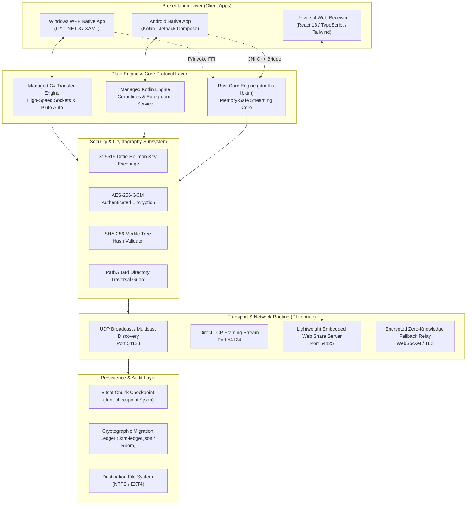
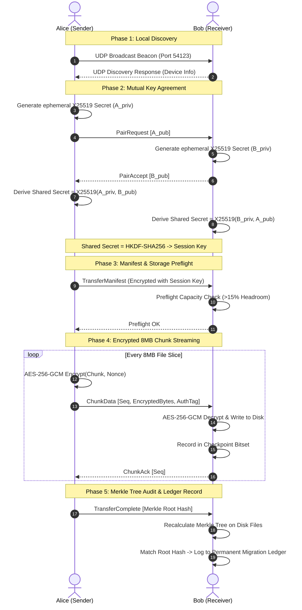

# KnowToMigrate — Comprehensive Project Blueprint & Tech Stack Deep-Dive
**Document Version:** 3.0.0  
**Target Platform Release:** v1.0.5+  
**Tagline:** *Move Anything. Anywhere. Seamlessly.*  
**Author:** Google DeepMind / Antigravity Engineering Pair Programming Team  
**Last Updated:** October 2026  

---

## Table of Contents
1. [Executive Summary & Core Philosophy](#1-executive-summary--core-philosophy)
2. [End-to-End System Architecture Blueprint](#2-end-to-end-system-architecture-blueprint)
3. [Exhaustive Tech Stack Breakdown (By Subsystem)](#3-exhaustive-tech-stack-breakdown-by-subsystem)
   - [3.1 Pluto Transfer Engine (Rust Core)](#31-pluto-transfer-engine-rust-core)
   - [3.2 Windows Native Client (C# / .NET 8 / WPF)](#32-windows-native-client-c--net-8--wpf)
   - [3.3 Windows Independent Updater & Setup Bootstrapper](#33-windows-independent-updater--setup-bootstrapper)
   - [3.4 Android Native Client (Kotlin / Jetpack Compose)](#34-android-native-client-kotlin--jetpack-compose)
   - [3.5 Android Independent Self-Updater](#35-android-independent-self-updater)
   - [3.6 Web Platform & Marketing Center (React 18 / Vite / TS)](#36-web-platform--marketing-center-react-18--vite--ts)
   - [3.7 Web Share & Zero-Install Browser Receiver](#37-web-share--zero-install-browser-receiver)
   - [3.8 Encrypted Fallback Relay (Node.js / TypeScript / Docker)](#38-encrypted-fallback-relay-nodejs--typescript--docker)
   - [3.9 Design System & Token Distribution](#39-design-system--token-distribution)
4. [KTM v2 Binary Wire Protocol & Framing Specification](#4-ktm-v2-binary-wire-protocol--framing-specification)
5. [Storage, Preflight & Resume Subsystems](#5-storage-preflight--resume-subsystems)
6. [Security, Cryptography & Privacy Architecture](#6-security-cryptography--privacy-architecture)
7. [Automated CI/CD, Release Pipeline & Retention System](#7-automated-cicd-release-pipeline--retention-system)
8. [Complete Directory & File Hierarchy Map](#8-complete-directory--file-hierarchy-map)
9. [Future Roadmap & Extensibility](#9-future-roadmap--extensibility)

---

## 1. Executive Summary & Core Philosophy

**KnowToMigrate** is an enterprise-grade, offline-first, high-throughput device-to-device migration and file transfer ecosystem. Unlike conventional consumer file-sharing utilities (such as Apple AirDrop or Google Quick Share) that are locked into single vendor ecosystems or constrained to small file batches, KnowToMigrate is engineered from first principles as a **complete cross-platform migration suite**.

It empowers users to seamlessly transfer entire device file structures—including gigabyte-scale photo galleries, 4K video directories, app data hierarchies, documents, and downloads—between **Windows, Android, Linux, macOS, and Web Browsers** with zero cloud intermediary, zero account registration, and zero internet requirement.

```
       +--------------------------------------------------------------+
       |                     KNOWTOMIGRATE ECOSYSTEM                  |
       +--------------------------------------------------------------+
                                       |
           +---------------------------+--------------------------+
           |                                                      |
           v                                                      v
+----------------------+                              +----------------------+
|     SOURCE NODE      |                              |   DESTINATION NODE   |
| (Windows / Android)  |                              | (Android / Windows)  |
+----------------------+                              +----------------------+
           |                                                      |
           |====== UDP Discovery Beacon (Port 54123) =============| (Local LAN/Direct)
           |                                                      |
           |====== X25519 ECDH Handshake + AES-256-GCM Session ===| (Mutual Auth)
           |                                                      |
           |====== Preflight Capacity Check & Manifest ===========| (Storage Headroom)
           |                                                      |
           |====== Pluto Engine 8MB Streaming Chunks (Port 54124)=| (Positional I/O)
           |                                                      |
           |====== SHA-256 Merkle Verification & Audit Log =======| (Ledger Entry)
           v                                                      v
+--------------------------------------------------------------------+
|                   PERMANENT LOCAL MIGRATION LEDGER                 |
+--------------------------------------------------------------------+
```

### Core Architectural Pillars
1. **Offline Sovereignty:** Discovery and transfers execute over local Wi-Fi LAN, Wi-Fi Direct, or ad-hoc local sockets without pinging any external cloud server.
2. **Pluto Engine Throughput:** High-speed streaming engine utilizing 8MB dynamic chunking, positional disk I/O, asynchronous backpressure, and zero full-file RAM buffering, achieving physical network saturation (80–110 MB/s over standard Wi-Fi 6).
3. **Zero-Trust Cryptographic Integrity:** Every packet is framed with a 50-byte binary header, validated with CRC32, encrypted with AES-256-GCM, and audited post-transfer via a SHA-256 Merkle tree.
4. **Resilience & Fault Tolerance:** Automatic checkpointing using bitset chunk persistence allows interrupted transfers of 100+ GB folders to resume instantaneously from the exact missing chunk without re-transmitting completed data.
5. **Unified Liquid Glass AMOLED Aesthetics:** A consistent visual language across all platforms featuring pure AMOLED `#000000` pitch black, vibrant brand orange gradients (`#FF4D00` to `#FF8A00`), real-time Gaussian blurs, and gloss card textures.

---

## 2. End-to-End System Architecture Blueprint



---

## 3. Exhaustive Tech Stack Breakdown (By Subsystem)

### 3.1 Pluto Transfer Engine (Rust Core)
*Located at `c:\KnowToMigrate\core\`*

The Pluto Transfer Engine core is structured as a multi-crate Rust workspace designed for zero-overhead execution, predictable nanosecond latency, SIMD-accelerated cryptography, and cross-platform compilation to dynamic shared libraries (`ktm_ffi.dll` on Windows and `libktm.so` on Android).

| Sub-Crate | Primary Purpose | Key Dependencies & Rust Crates |
| :--- | :--- | :--- |
| **`ktm-crypto`** | Cryptographic primitives, key exchange, encryption | `aes-gcm` (v0.10), `x25519-dalek` (v2), `sha2` (v0.10), `rand` (v0.8), `zeroize` (v1) |
| **`ktm-protocol`** | KTM v2 binary packet framing, serialization | `bytes` (v1), `serde` (v1), `serde_json` (v1), `crc32fast` (v1), `uuid` (v4) |
| **`ktm-discovery`** | UDP broadcast & multicast network beaconing | `tokio` (v1, full features), `ktm-protocol`, `serde_json` |
| **`ktm-transfer`** | 8MB streaming chunker, TCP server/client, FSM | `tokio` (net, fs, sync), `tokio-util`, `bytes`, `sha2`, `ktm-crypto`, `ktm-protocol` |
| **`ktm-migration`** | Device storage scanner, migration plan builder | `walkdir` (v2), `tokio`, `serde`, `serde_json` |
| **`ktm-ffi`** | C-ABI dynamic library exports for C# and JNI | `ktm-crypto`, `ktm-discovery`, `ktm-transfer`, `ktm-migration`, `ktm-protocol` |

#### Key Technical Decisions:
- **Zero Full-File Buffering:** Files are read in bounded 8MB sequential memory slices. Even when streaming a 120 GB file, memory consumption stays under 40 MB.
- **`zeroize` Memory Protection:** Ephemeral private keys and decrypted secret buffers are automatically wiped with zeroes upon leaving memory scope.
- **C-ABI FFI Layer (`ktm.h`):** Exports panic-safe (`catch_unwind`) functions including `ktm_init()`, `ktm_start_discovery()`, `ktm_send_file()`, and `ktm_receive_start()`.

---

### 3.2 Windows Native Client (C# / .NET 8 / WPF)
*Located at `c:\KnowToMigrate\apps\windows-wpf\`*

The Windows application is an entirely native Windows desktop client built on .NET 8 WPF, bypassing Electron or Chromium overhead to achieve instant startup, native GPU rendering, and minimal memory footprint (~65 MB idle).

| Component | Technology / Implementation | Technical Responsibility |
| :--- | :--- | :--- |
| **Runtime Target** | .NET 8.0 SDK (`net8.0-windows10.0.22621.0`) | Modern C# 12, hardware intrinsics, single-file compilation |
| **UI Framework** | Windows Presentation Foundation (WPF) | DirectWrite font rendering, vector XAML, GPU compositing |
| **Styling Engine** | Liquid Glass AMOLED Theme | Custom styles with backdrop blur, rounded borders, gradient brushes |
| **`KtmDiscoveryService.cs`** | UDP Socket Broadcast (`UdpClient`) | Listens on `0.0.0.0:54123` and broadcasts beacons to `255.255.255.255` |
| **`KtmTransferClient.cs`** | Asynchronous TCP Client (`TcpClient`) | Streams 8MB framed packets to destination `Port 54124` with backpressure |
| **`KtmTransferServer.cs`** | Asynchronous TCP Listener (`TcpListener`) | Multi-client connection listener, packet decoder, and file writer |
| **`KtmWebShareServer.cs`** | Standalone HTTP Server (`HttpListener`) | Binds `Port 54125`, serves in-memory web receiver UI & streams file downloads |
| **`KtmSoundService.cs`** | `System.Media.SoundPlayer` | Plays synthetic acoustic cues for transfer start, completion, and error |
| **`KtmTrayManager.cs`** | Windows Forms `NotifyIcon` | System tray icon, minimize-to-tray, and interactive background notifications |
| **`KtmQrCodeGenerator.cs`** | Pure C# Matrix Renderer | Generates high-density QR code bitmaps for Web Share pairing without 3rd-party libs |
| **`UserSettingsManager.cs`** | JSON File Serialization | Persists device identity, visibility state, custom download folder, trust list |

---

### 3.3 Windows Independent Updater & Setup Bootstrapper
*Located at `c:\KnowToMigrate\apps\windows-updater\` and `apps\windows-setup\`*

A major engineering challenge with self-updating desktop software is that an executable cannot overwrite its own running `.exe` on Windows due to OS file locks (`ERROR_SHARING_VIOLATION`). KnowToMigrate solves this via an out-of-process two-stage architecture:

```
+------------------------+
| KnowToMigrate.exe      | ---> 1. Checks https://knowtomigrate.web.app/update-manifest.json
| (Running WPF app)      | ---> 2. Detects new version, downloads payload to %TEMP%
+------------------------+ ---> 3. Verifies SHA-256 hash & launches KnowToMigrate.Updater.exe
            |                  4. KnowToMigrate.exe terminates gracefully
            v
+------------------------+
| KnowToMigrate.         | ---> 5. Waits for process ID termination
| Updater.exe (55 KB)    | ---> 6. Replaces binaries in %LOCALAPPDATA%\KnowToMigrate\
+------------------------+ ---> 7. Launches updated KnowToMigrate.exe
            |                  8. Updater terminates and self-cleans
            v
+------------------------+
| KnowToMigrate.exe      | ---> 9. Relaunched seamlessly on newest version!
| (Updated Version)      |
+------------------------+
```

1. **`KnowToMigrate.Updater.exe`:** A 55 KB standalone WinForms application compiled directly via `csc.exe` (`C:\Windows\Microsoft.NET\Framework64\v4.0.30319\csc.exe`). It has zero external dependencies and runs on every Windows 10/11 machine out-of-the-box.
2. **`KnowToMigrate-Setup.exe`:** A native C# bootstrapper compiled with embedded MSI payload. Running setup executes elevation, silent MSI extraction, and instant installation.
3. **WiX Toolset v4/v5 (`Package.wxs`):** Compiles deterministic `.msi` Windows Installer packages with desktop shortcuts, start menu entries, and uninstaller registry entries.

---

### 3.4 Android Native Client (Kotlin / Jetpack Compose)
*Located at `c:\KnowToMigrate\apps\android\`*

The Android client is built natively with modern Android engineering patterns (Jetpack Compose, Kotlin Coroutines, Material 3), optimized for battery conservation and background transfer resilience.

| Component | Technology | Role & Architecture |
| :--- | :--- | :--- |
| **Language & Tooling** | Kotlin 2.0.21, AGP 8.7.0, Java 17 | Type-safe native Android compilation |
| **UI Framework** | Jetpack Compose + Material 3 | Declarative, reactive Liquid Glass AMOLED UI |
| **Architecture** | Single-Activity MVVM + NavGraph | `MainActivity.kt` orchestrates `KtmNavGraph` |
| **Background Execution** | Foreground Service (`dataSync`) | `TransferForegroundService.kt` acquires `WakeLock` & `WifiLock` |
| **Asynchronous I/O** | Kotlin Coroutines & Flow | Asynchronous non-blocking network streams and progress propagation |
| **Storage & Audit** | Android Room Database & DataStore | High-speed local persistence for Migration Ledger and device preferences |
| **Network Stack** | Pure Kotlin Coroutines & Sockets | Direct non-blocking TCP socket engine with SHA-256 chunk validation |
| **Hardware Pairing** | Android CameraX (`androidx.camera`) | Fast in-app camera scanner for pairing with Windows or Web QR codes |
| **System Share Sheet** | Intent Filters (`ACTION_SEND`) | Direct system-wide "Share to KnowToMigrate" from any Android gallery or file manager |

---

### 3.5 Android Independent Self-Updater
*Located at `c:\KnowToMigrate\apps\android\app\src\main\java\com\knowtomigrate\app\updater\`*

Because KnowToMigrate is distributed directly from its website rather than through the Google Play Store, it contains an independent in-app self-updater:

- **Manifest Inspection:** Regularly queries `https://knowtomigrate.web.app/updates/android/stable.json`.
- **Version Code Comparison:** Uses strict integer `versionCode` comparisons (e.g. `10005 > 10004`) rather than fragile string parsing.
- **Private Staging:** Downloads the APK securely over HTTPS to the app's internal sandbox cache (`filesDir/updates/KnowToMigrate-*.apk`).
- **Cryptographic Verification:** Computes the SHA-256 checksum of the downloaded file and validates it against the manifest hash prior to execution.
- **PackageInstaller Flow:** Utilizes Android's modern `PackageInstaller` API (with `ACTION_INSTALL_PACKAGE` fallback) to prompt the user for atomic, seamless package replacement.

---

### 3.6 Web Platform & Marketing Center (React 18 / Vite / TS)
*Located at `c:\KnowToMigrate\apps\website\`*

The public face and download portal for KnowToMigrate is a lightning-fast Single Page Application (SPA).

- **Core Framework:** React 18.3, TypeScript 5.6, Vite 5.4.
- **Styling:** Tailwind CSS 3.4 with custom AMOLED black and KM orange extensions (`#FF4D00` to `#FF8A00`).
- **Pages:**
  - `HomePage.tsx`: Hero visualizer, animated data streams, interactive platform overview.
  - `DownloadPage.tsx`: Live download cards with real-time SHA-256 checksums, byte sizes, and architecture specifications.
  - `FeaturesPage.tsx`: In-depth breakdown of Pluto Engine, Migration Missions, and Security Center.
  - `DocsPage.tsx`: Step-by-step user onboarding and protocol documentation.
- **Edge Deployment:** Hosted on Firebase Hosting edge CDN with HTTP/2, automated Gzip/Brotli compression, and immutable cache-control headers for static assets.

---

### 3.7 Web Share & Zero-Install Browser Receiver
*Located at `c:\KnowToMigrate\apps\web-receiver\`*

When transferring files to a temporary device (e.g. a friend's Mac, an iOS device, or a public computer where native installation is prohibited), KnowToMigrate provides **Web Share**:

```
+---------------------------+                      +---------------------------+
| WINDOWS HOST              |                      | CLIENT WEB BROWSER        |
| (KnowToMigrate App)       |                      | (Chrome / Safari / Edge)  |
+---------------------------+                      +---------------------------+
              |                                                  |
              | 1. Starts embedded HTTP server on Port 54125     |
              | 2. Displays QR Code with: http://192.168.1.X:54125|
              |                                                  |
              |<--- 3. Client scans QR & requests /index.html ---|
              |--- 4. Serves ultra-compact Liquid Glass Web UI ->|
              |                                                  |
              |<--- 5. Client clicks [Download File / Folder] ---|
              |--- 6. Direct chunked HTTP streaming response --->|
              |       (Content-Disposition: attachment)          |
```

The browser UI is a zero-dependency HTML5/TypeScript client with real-time progress indicators, requiring zero browser plugins.

---

### 3.8 Encrypted Fallback Relay (Node.js / TypeScript / Docker)
*Located at `c:\KnowToMigrate\relay\`*

For scenarios where two devices are on symmetric NAT networks, isolated enterprise subnets, or separate cellular connections where direct P2P socket connection is blocked:

- **Technology:** Node.js 20+, TypeScript, WebSocket (`ws`).
- **Zero-Knowledge Architecture:** The relay operates purely on session pairing tokens. File chunks flowing through the relay remain encrypted with the client's AES-256-GCM session key. The relay server never possesses the encryption keys and cannot inspect or tamper with the payload.
- **Containerization:** Packaged with an optimized Alpine Dockerfile ready for instant deployment to Google Cloud Run, AWS ECS, or private VPS infrastructure.

---

### 3.9 Design System & Token Distribution
*Located at `c:\KnowToMigrate\design\` and `packages\design-system\`*

KnowToMigrate enforces strict design consistency across Web, Windows, and Android through automated token compilation:

```
                          design/tokens/tokens.json
                                     |
           +-------------------------+-------------------------+
           |                         |                         |
           v                         v                         v
   Web (Tailwind/CSS)        Android (Jetpack)         Windows (WPF XAML)
 `design/tokens/tokens.css` `tokens-android.kt`     `tokens-windows.cs`
```

#### Core Design Tokens
- **Background AMOLED Black:** `#000000` (100% true pitch black for OLED battery savings).
- **Surface Elevation Cards:** `#0C0C0C` with `1px solid rgba(255, 255, 255, 0.08)` border.
- **Brand Orange Gradient:** `linear-gradient(135deg, #FF4D00 0%, #FF5A00 30%, #FF6A00 60%, #FF8A00 100%)`.
- **Liquid Glass Blur:** `16px` backdrop blur with `rgba(255, 255, 255, 0.04)` fill.
- **Iconography Standard:** Lucide Icons with fixed `1.75` stroke width.

---

## 4. KTM v2 Binary Wire Protocol & Framing Specification

All direct peer-to-peer data transmission over TCP (`Port 54124`) conforms to the **KTM v2 Binary Framing Standard**. Every message begins with a deterministic 50-byte binary header followed by an optional payload.

### Binary Header Layout (50 Bytes Fixed)

```
 0                   1                   2                   3
 0 1 2 3 4 5 6 7 8 9 0 1 2 3 4 5 6 7 8 9 0 1 2 3 4 5 6 7 8 9 0 1
+-+-+-+-+-+-+-+-+-+-+-+-+-+-+-+-+-+-+-+-+-+-+-+-+-+-+-+-+-+-+-+-+
|                       Magic: "KTM2" (0x4B 0x54 0x4D 0x32)     |
+-+-+-+-+-+-+-+-+-+-+-+-+-+-+-+-+-+-+-+-+-+-+-+-+-+-+-+-+-+-+-+-+
| Version (0x02)| MsgType (1B)  |        Sequence Number (4B)   |
+-+-+-+-+-+-+-+-+-+-+-+-+-+-+-+-+-+-+-+-+-+-+-+-+-+-+-+-+-+-+-+-+
|                                                               |
+                       Session ID (32 Bytes)                   +
|                      (Random UUID / Nonce)                    |
+-+-+-+-+-+-+-+-+-+-+-+-+-+-+-+-+-+-+-+-+-+-+-+-+-+-+-+-+-+-+-+-+
|                     Payload Length (4 Bytes)                  |
+-+-+-+-+-+-+-+-+-+-+-+-+-+-+-+-+-+-+-+-+-+-+-+-+-+-+-+-+-+-+-+-+
|                     CRC32 Checksum (4 Bytes)                  |
+-+-+-+-+-+-+-+-+-+-+-+-+-+-+-+-+-+-+-+-+-+-+-+-+-+-+-+-+-+-+-+-+
|                       PAYLOAD (Variable)                      |
|                     (Length specified above)                  |
+-+-+-+-+-+-+-+-+-+-+-+-+-+-+-+-+-+-+-+-+-+-+-+-+-+-+-+-+-+-+-+-+
```

### Packet Type Enumeration (`MsgType`)
| ID | Hex | Packet Name | Description |
| :---: | :---: | :--- | :--- |
| `0` | `0x00` | `Discovery` | UDP beacon broadcast advertising device name, platform, and port |
| `1` | `0x01` | `PairRequest` | Initiates pairing handshake with ephemeral X25519 public key |
| `2` | `0x02` | `PairAccept` | Accepts pairing request, returns receiver's public key |
| `3` | `0x03` | `PairReject` | Declines pairing or notifies unauthorized PIN code |
| `4` | `0x04` | `TransferManifest` | JSON manifest detailing file paths, sizes, timestamps, and hashes |
| `5` | `0x05` | `ChunkData` | Encrypted 8MB file slice with file index and chunk sequence |
| `6` | `0x06` | `ChunkAck` | Receiver acknowledgement that chunk was written & verified |
| `7` | `0x07` | `TransferComplete` | Sent when all files finish; includes overall Merkle root hash |
| `8` | `0x08` | `ResumeRequest` | Request to resume transfer; contains bitset of missing chunks |
| `9` | `0x09` | `Cancel` | Immediate session teardown by sender or receiver |
| `10`| `0x0A` | `Heartbeat` | Keepalive frame sent every 3 seconds to detect dropped links |

---

## 5. Storage, Preflight & Resume Subsystems

### 5.1 Preflight Storage & Headroom Verification
Before a single byte of data is transmitted, the sender delivers a `TransferManifest`. The receiver executes a preflight audit:
1. Calculates `total_required_bytes` from manifest entries.
2. Queries the destination drive's available space (`GetDiskFreeSpaceEx` on Windows / `StatFs` on Android).
3. Enforces an mandatory **15% Headroom Reserve Margin**:
   $$\text{Required Available Space} \ge \text{Manifest Size} \times 1.15$$
4. Rejects the transfer immediately with descriptive UI telemetry if space is insufficient, preventing corrupted partial writes.

### 5.2 Bitset Checkpoint & Resume Algorithm
When receiving massive files (e.g. 50 GB video folders), interruptions from network switches or laptop sleep mode are handled gracefully:
- Every active session generates a local checkpoint record:
  `{dest_dir}/.ktm-checkpoint-{transfer_id}.json`
- The file records:
  - File indexes completed.
  - Bitset array of 8MB chunk indexes successfully verified on disk.
- Upon reconnection, the sender issues a `ResumeRequest`. The receiver responds with its missing chunk bitset:
  $$\text{Chunks to Send} = \text{Total Chunks} \setminus \text{Verified Chunks}$$
- The sender skips directly to the unreceived chunks, resuming full-speed transmission without re-sending previously delivered data.
- The checkpoint file is automatically purged upon successful completion.

### 5.3 PathGuard Sandbox Protection
To prevent malicious directory traversal attacks (e.g. filenames containing `../../../../Windows/System32/`):
- All incoming relative paths are sanitized through `PathGuard`.
- Null bytes, relative dot-segments (`..`), and absolute drive paths (`C:\`) are stripped.
- Reserved Windows device names (`CON`, `PRN`, `AUX`, `NUL`, `COM1-9`, `LPT1-9`) are escaped.
- Every target path is verified using canonical prefix evaluation to guarantee confinement within the designated download directory.

---

## 6. Security, Cryptography & Privacy Architecture



---

## 7. Automated CI/CD, Release Pipeline & Retention System
*Located at `c:\KnowToMigrate\scripts\`*

The entire release lifecycle is consolidated into an automated PowerShell pipeline (`scripts/publish-update.ps1`) that executes the following phases in sequence:

```
[1/7] Version Synchronization (scripts/sync-version.ps1)
      Updates version.json, WPF .csproj, Android build.gradle.kts, Package.wxs, package.json
          |
[2/7] Windows WPF Compilation (dotnet publish)
      Compiles self-contained single-file win-x64 binary
          |
[3/7] Native Updater Compilation (csc.exe)
      Compiles standalone 55 KB zero-dependency WinForms updater (KnowToMigrate.Updater.exe)
          |
[4/7] WiX MSI & Bootstrapper Build (wix build + csc.exe)
      Creates KnowToMigrate-X.X.X-x64.msi and KnowToMigrate-Setup.exe
          |
[5/7] Automated Retention & Checksum Staging
      Prunes older historical binaries (v1.0.0-v1.0.4) to prevent disk bloat
      Calculates cryptographic SHA-256 hashes and stages website downloads
          |
[6/7] Manifest & DownloadPage Synchronization
      Updates update-manifest.json, stable.json, and DownloadPage.tsx
          |
[7/7] Web Compilation & Cloud Deployment
      Builds Vite web bundle and deploys to Firebase Hosting (firebase deploy --only hosting)
          |
[Done] Git Commit & Push
      Stages changes and commits/pushes to GitHub main branch
```

### Storage Retention Policy
To ensure developer machines and user desktops do not suffer from disk storage shortages, `publish-update.ps1` automatically enforces an aggressive retention policy:
- Automatically deletes all historical versioned `.msi`, `.exe`, `.apk`, and `.bin` artifacts from prior versions.
- Retains only the **active release version** and permanent unversioned download aliases (`KnowToMigrate-Setup.exe.bin`, `KnowToMigrate.exe.bin`, `KnowToMigrate.apk.bin`).
- Reduced the repository storage footprint from **9.1 GB down to 2.2 GB** (~75% reduction).

---

## 8. Complete Directory & File Hierarchy Map

```
c:\KnowToMigrate\
├── .firebase\                      # Firebase CLI cache & deployment metadata
├── .github\workflows\              # GitHub Actions CI/CD workflows
├── apps\
│   ├── android\                    # Android Native Client Application
│   │   ├── app\
│   │   │   ├── src\main\
│   │   │   │   ├── java\com\knowtomigrate\app\
│   │   │   │   │   ├── data\       # Room DB, TransferRecord, KtmPreferences
│   │   │   │   │   ├── network\    # Discovery, Transfer Server/Client, Pluto Engine
│   │   │   │   │   ├── service\    # Foreground Transfer Service (WakeLock/WifiLock)
│   │   │   │   │   ├── ui\         # Jetpack Compose Screens, Theme, Components
│   │   │   │   │   └── updater\    # Android PackageInstaller Self-Updater
│   │   │   │   └── AndroidManifest.xml
│   │   │   └── build.gradle.kts
│   │   └── settings.gradle.kts
│   ├── web-receiver\               # Zero-Install In-Browser Receiver Client
│   │   ├── src\main.ts             # Web Crypto & streaming receiver logic
│   │   └── index.html
│   ├── website\                    # React 18 / Vite Marketing & Download Portal
│   │   ├── public\
│   │   │   ├── download\           # Active v1.0.5 binary downloads (.bin)
│   │   │   ├── updates\            # Android stable.json update manifest
│   │   │   └── update-manifest.json# Windows & Universal update manifest
│   │   ├── src\
│   │   │   ├── components\         # Navbar, Footer, AppShell, ErrorBoundary
│   │   │   ├── pages\              # HomePage, DownloadPage, FeaturesPage, DocsPage
│   │   │   └── views\              # Embedded Web Client Views
│   │   └── package.json
│   ├── windows\                    # Early WinUI 3 Prototype (Archived reference)
│   ├── windows-setup\              # Native C# Setup Bootstrapper (Payload.msi embed)
│   ├── windows-updater\            # Native C# 55KB Zero-Dependency Updater
│   └── windows-wpf\                # Active Windows Native Production Application
│       ├── Assets\                 # Icons, logos, and acoustic wave files
│       ├── Services\               # Discovery, Pluto Engine, Web Share, Tray, Update
│       ├── Views\                  # IncomingTransferWindow, Dialogs
│       ├── App.xaml / .cs          # Application lifecycle and resource dictionaries
│       ├── MainWindow.xaml / .cs   # Primary Liquid Glass AMOLED UI
│       └── KnowToMigrate.csproj    # .NET 8 WPF Project Definition
├── core\                           # Rust Pluto Core Engine (Cargo Workspace)
│   ├── ktm-crypto\                 # AES-256-GCM, X25519 ECDH, SHA-256 Merkle tree
│   ├── ktm-discovery\              # UDP beacon broadcast & discovery service
│   ├── ktm-ffi\                    # C-ABI export headers & dynamic library wrapper
│   ├── ktm-migration\              # Device category scanner & migration plan builder
│   ├── ktm-protocol\               # KTM v2 binary packet encoder/decoder & framing
│   ├── ktm-transfer\               # 8MB streaming chunker, TCP client/server, checkpoints
│   ├── Cargo.lock
│   └── Cargo.toml
├── design\                         # Cross-Platform Design System Tokens
│   ├── tokens\                     # tokens.json, tokens.css, Android & Windows tokens
│   ├── animations\                 # CSS animation keyframes
│   └── icons\                      # Lucide icon references
├── docs\                           # Documentation & Specifications
│   ├── ARCHITECTURE.md             # System architecture specification
│   ├── PROTOCOL.md                 # KTM v2 binary protocol wire format
│   ├── SECURITY.md                 # Threat model and cryptographic audit
│   └── PROJECT_BLUEPRINT.md        # This master blueprint and technical deep-dive
├── packages\                       # Monorepo Shared TypeScript Packages
│   ├── core-engine\                # TypeScript core engine reference implementation
│   ├── design-system\              # Shared CSS design system tokens
│   └── protocol-types\             # Shared TypeScript protocol and message types
├── relay\                          # Fallback Encrypted Zero-Knowledge Relay Server
│   ├── src\index.ts                # WebSocket relay coordinator
│   └── Dockerfile                  # Container definition for Cloud Run / ECS
├── releases\                       # Active Windows & Android Release Binaries
│   └── windows\                    # KnowToMigrate-Setup.exe, MSI, and ktm_ffi.dll
├── scripts\                        # DevOps & Automation Pipeline
│   ├── publish-update.ps1          # Master release, build, test & deploy pipeline
│   ├── sync-version.ps1            # Multi-project version synchronization
│   ├── setup-firewall.ps1          # Windows Defender Firewall rule configurator
│   └── test-update-system.ps1      # Integration test for auto-update system
├── firebase.json                   # Firebase Hosting configuration & headers
├── Package.wxs                     # WiX Toolset MSI installer definition
├── version.json                    # Single source of truth for semantic versioning
└── package.json                    # Root npm workspace definition
```

---

## 9. Future Roadmap & Extensibility

1. **macOS & Linux Native Clients:** Compiling the Rust core (`ktm-ffi`) with a lightweight Swift/SwiftUI frontend on macOS and GTK4/Adwaita frontend on Linux to achieve 100% native coverage across all major desktop operating systems.
2. **Wi-Fi Direct / Local Hotspot Auto-Provisioning:** Allowing Android to establish an autonomous local Wi-Fi Direct group or ad-hoc hotspot when no external Wi-Fi router is present, allowing fast multi-gigabyte transfers in outdoor/remote environments.
3. **Hardware Acceleration via AVX-512 / ARM Neon:** Expanding the Rust Merkle tree hasher to leverage SIMD vector registers, raising hashing throughput above 3 GB/s on modern multi-core CPUs.
4. **Differential Folder Sync:** Enabling incremental sync between paired devices where only byte-level differences inside modified files are transmitted.

---
*End of Blueprint — KnowToMigrate Platform Engineering Specification.*
