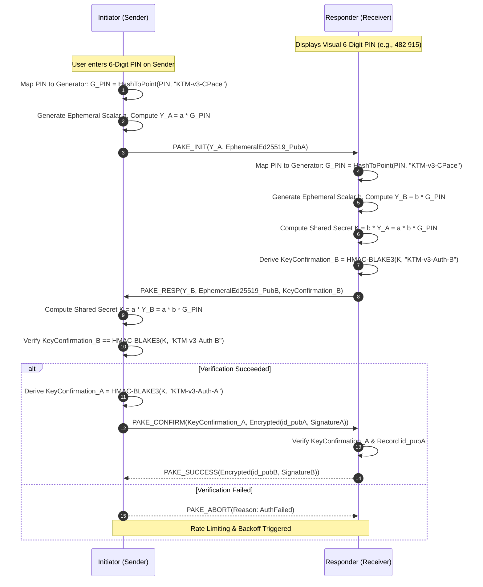
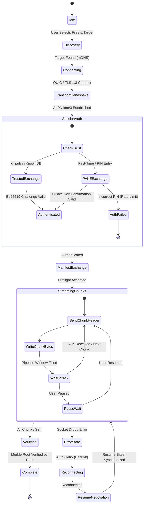
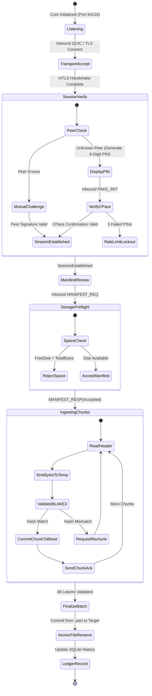

# KnowToMigrate Protocol Specification (KTM v3.0)
**Version:** 3.0.0-DRAFT  
**Date:** October 25, 2026  
**Status:** Approved Architecture & Implementation Standard  
**Authors:** KnowToMigrate Core Engineering Team

---

## 1. Executive Summary & Security Objectives

This specification defines **KTM v3.0**, the next-generation unified transport, session, and transfer protocol for KnowToMigrate. It replaces legacy ad-hoc framing and unencrypted TCP socket streaming with an industry-standard, cryptographically authentic, and fault-tolerant architecture.

### Core Security Guarantees
1. **Confidentiality on the Wire:** All file contents, manifests, device identifiers, and metadata are encrypted in-flight using standard **TLS 1.3 (RFC 8446)** or **QUIC (RFC 9000 / RFC 9001)**. No unencrypted plaintext is ever transmitted across local or remote networks.
2. **Cryptographic Identity & Mutual Authentication:** Devices maintain persistent **Ed25519** identity keypairs. Mutual trust is established either via **PAKE (Password-Authenticated Key Exchange)** over a visual 6-digit PIN, out-of-band **QR code pairing**, or signed identity challenge exchange for pre-trusted devices.
3. **Strict Non-Spoofable Discovery:** Plaintext UDP broadcast beacons containing readable device names are eliminated. Discovery uses **mDNS / DNS-SD** carrying exclusively ephemeral service identifiers and truncated public key fingerprints.
4. **Authenticity & Merkle Chunk Verification:** Transfer manifests are signed by the sender's long-term identity key. Every individual chunk (default 4 MiB) is validated upon arrival against a **BLAKE3 Merkle Tree**. Resumes re-request only corrupt or missing chunks via verified bitsets.
5. **Single Shared Implementation:** The protocol logic, cryptographic state machines, chunking pipelines, and durable ledger are implemented exclusively in a single shared Rust core (`ktm-core`), exposed via **UniFFI** to Android (Kotlin) and **C ABI** to Windows (.NET 8), preventing behavioral drift.

---

## 2. Protocol Architecture & Layering Model

The KTM v3.0 stack is cleanly partitioned into four strictly decoupled layers:

```
+-------------------------------------------------------------------------+
|                         APPLICATION LAYER                               |
|   Windows WPF UI / Android Jetpack Compose / Storage IO / Notifications |
+-------------------------------------------------------------------------+
                                    |
                                    v (UniFFI / C ABI)
+-------------------------------------------------------------------------+
|                          TRANSFER LAYER                                 |
|   Signed Manifests | BLAKE3 Merkle Verification | Durable Bitset Resume |
+-------------------------------------------------------------------------+
                                    |
                                    v
+-------------------------------------------------------------------------+
|                          SESSION LAYER                                  |
|   Ed25519 Identities | CPace/SPAKE2 PAKE | QR Pairing | CBOR Envelope   |
+-------------------------------------------------------------------------+
                                    |
                                    v
+-------------------------------------------------------------------------+
|                         TRANSPORT LAYER                                 |
|   QUIC (Primary, UDP) / TLS 1.3 (Fallback, TCP) | ALPN: "ktm/3"         |
+-------------------------------------------------------------------------+
```

Platform UI and operating system code interact **only** with the high-level transfer and session state observables exposed by the Rust core.

---

## 3. Layer 1: Transport & Wire Security

### 3.1 Transport Profiles & ALPN Negotiation

| Transport Profile | Protocol Baseline | Port | ALPN Identifier | Primary Advantages |
| :--- | :--- | :--- | :--- | :--- |
| **QUIC (Primary)** | RFC 9000, RFC 9001 | 54124/UDP | `ktm/3` | Connection migration across Wi-Fi & cellular hotspots, zero-RTT resumption, stream multiplexing without head-of-line blocking. |
| **TLS 1.3 (Fallback)** | RFC 8446 over TCP | 54124/TCP | `ktm/3` | Universal firewall and local intranet traversal where UDP is filtered or throttled. |

### 3.2 Ephemeral mTLS Certificates
During the initial transport handshake before identity authentication:
1. Both sender and receiver generate ephemeral, self-signed X.509 certificates containing an ephemeral **Ed25519** public key with a validity window of 2 hours.
2. Standard TLS 1.3 cipher suites are restricted to:
   - `TLS_AES_256_GCM_SHA384`
   - `TLS_CHACHA20_POLY1305_SHA256`
   - `TLS_AES_128_GCM_SHA256`
3. The TLS/QUIC session provides wire confidentiality and forward secrecy. Device-level identity authentication is executed immediately inside the encrypted session at Layer 2.

---

## 4. Layer 2: Session, Identity & Pairing

### 4.1 Device Identity Model
- Every device generates a persistent **Ed25519** identity keypair upon installation:
  $$\text{Identity} = (\text{id\_priv}, \text{id\_pub})$$
- **Fingerprint Calculation:**
  $$\text{Fingerprint} = \text{BLAKE3}(\text{id\_pub})[0..16] \quad \text{(Formatted as hex or hyphenated 32-char string)}$$
- The identity public key and trusted device database are stored securely:
  - Windows: DPAPI / Encrypted local application storage.
  - Android: EncryptedSharedPreferences backed by Android Keystore (Hardware TEE / StrongBox).

### 4.2 Pairing Mode 1: PIN-Bound Key Exchange (PAKE via CPace)
When devices are not pre-paired, they establish trust using a 6-digit numeric PIN ($PIN \in [100000, 999999]$) displayed on the receiver. The PIN is **cryptographically bound** to the key exchange using **CPace** (RFC 9383):



#### Rate Limiting & Brute-Force Defense
Because the 6-digit PIN has only $10^6$ combinations, strict rate-limiting state transitions are enforced:
- **Attempts 1–2:** Immediate feedback with 500 ms minimum computation delay.
- **Attempt 3:** Mandatory 5-second backoff.
- **Attempt 4:** Mandatory 30-second backoff.
- **Attempt 5:** Session lock. The receiver regenerates a new PIN and invalidates the session.

### 4.3 Pairing Mode 2: Out-of-Band QR Code
For rapid zero-typing pairing, the receiver generates a QR code encoding a canonical URI:
```text
ktm3://pair?v=3&fp=8f14b301c9a8...&pk=A9bc4E...&sec=mZ29...&ep=192.168.1.140:54124
```
- `v`: Protocol version (`3`).
- `fp`: Sender/Receiver identity fingerprint (16 bytes hex).
- `pk`: Base64-encoded Ed25519 identity public key.
- `sec`: 256-bit cryptographically random one-time secret token (CSPRNG).
- `ep`: Primary socket endpoint (`IP:Port`).

When scanned, the initiator directly presents `sec` in the encrypted session layer, establishing mutual key authentication with zero user prompt.

### 4.4 Pairing Mode 3: Pre-Trusted Mutual Authentication
When both devices already have each other's `id_pub` in their trusted database:
1. Sender issues `AUTH_CHALLENGE(NonceSender, id_pubSender)`.
2. Receiver responds with `AUTH_RESPONSE(NonceReceiver, SignatureReceiver)`, where:
   $$\text{SignatureReceiver} = \text{Ed25519Sign}(\text{id\_privReceiver}, \text{NonceSender} \mathbin{\Vert} \text{NonceReceiver} \mathbin{\Vert} \text{SessionId})$$
3. Sender verifies against stored `id_pubReceiver` and returns its reciprocal signature. Zero visual interaction or PIN entry is required.

---

## 5. Layer 3: Framing & Message Encoding

### 5.1 Binary Framing Architecture
All control messages, handshakes, manifests, and chunk headers are encoded in **Canonical CBOR (RFC 8949)**.
Every frame on the QUIC stream or TLS stream is prefixed with an 8-byte framing header:

```
 0                   1                   2                   3
 0 1 2 3 4 5 6 7 8 9 0 1 2 3 4 5 6 7 8 9 0 1 2 3 4 5 6 7 8 9 0 1
+-+-+-+-+-+-+-+-+-+-+-+-+-+-+-+-+-+-+-+-+-+-+-+-+-+-+-+-+-+-+-+-+
|       Magic: 'K' 'T' 'M' '3' (0x4B 0x54 0x4D 0x33)           |
+-+-+-+-+-+-+-+-+-+-+-+-+-+-+-+-+-+-+-+-+-+-+-+-+-+-+-+-+-+-+-+-+
|  MsgType (1B) | Flags (1B)    |      Payload Length (2B BE)   |
+-+-+-+-+-+-+-+-+-+-+-+-+-+-+-+-+-+-+-+-+-+-+-+-+-+-+-+-+-+-+-+-+
|                    CBOR Payload (Variable)                    |
|                              ...                              |
+-+-+-+-+-+-+-+-+-+-+-+-+-+-+-+-+-+-+-+-+-+-+-+-+-+-+-+-+-+-+-+-+
```

### 5.2 Message Types (`MsgType`)

| Code | Identifier | Direction | Purpose |
| :---: | :--- | :---: | :--- |
| `0x01` | `HELLO` | Sender $\rightarrow$ Receiver | Initiates protocol negotiation, capabilities, protocol version. |
| `0x02` | `HELLO_ACK` | Receiver $\rightarrow$ Sender | Confirms negotiated features, session ID. |
| `0x10` | `PAKE_INIT` | Sender $\rightarrow$ Receiver | Initiates CPace/SPAKE2 exchange. |
| `0x11` | `PAKE_RESP` | Receiver $\rightarrow$ Sender | Responder PAKE step with confirmation tag. |
| `0x12` | `PAKE_CONFIRM` | Sender $\rightarrow$ Receiver | Finalizes mutual authentication. |
| `0x13` | `PAKE_SUCCESS` | Receiver $\rightarrow$ Sender | PAKE exchange complete. |
| `0x20` | `MANIFEST_REQ` | Sender $\rightarrow$ Receiver | Sends signed batch manifest with Merkle roots. |
| `0x21` | `MANIFEST_RESP`| Receiver $\rightarrow$ Sender | Preflight verdict (accepted, rejected, insufficient space, missing bitset). |
| `0x30` | `CHUNK_HEADER` | Sender $\rightarrow$ Receiver | Header preceding raw chunk stream bytes. |
| `0x31` | `CHUNK_ACK` | Receiver $\rightarrow$ Sender | Cumulative or selective chunk verification receipt. |
| `0x40` | `RESUME_REQ` | Sender $\leftrightarrow$ Receiver | Requests verified chunk bitmask to resume interrupted transfer. |
| `0x50` | `CONTROL_SYNC` | Bidirectional | Authenticated clipboard sync / control commands. |
| `0xFF` | `SESSION_ABORT`| Bidirectional | Error code, security alert, or cancellation. |

---

## 6. Layer 4: Transfer, Manifest & Merkle Chunk Verification

### 6.1 Signed Manifest Structure
The batch manifest is defined in CBOR Schema:

```cbor
Manifest = {
    1: tstr,                      ; BatchId (UUID v4)
    2: uint,                      ; TotalBytes (64-bit integer)
    3: uint,                      ; TotalFiles
    4: [* FileEntry ],            ; Itemized files
    5: bstr,                      ; BatchMerkleRoot (32-byte BLAKE3 hash)
    6: bstr,                      ; SenderSignature (64-byte Ed25519 signature)
}

FileEntry = {
    1: uint,                      ; FileIndex (0-based)
    2: tstr,                      ; RelativePath (Sanitized, forward-slash)
    3: uint,                      ; FileSizeBytes
    4: uint,                      ; ModifiedTimestamp (Unix ms)
    5: uint,                      ; FileAttributes (Bitmask: read-only, hidden, etc.)
    6: bstr,                      ; FileMerkleRoot (32-byte BLAKE3 hash)
    7: uint,                      ; ChunkCount
}
```

#### Manifest Signature Rule
$$\text{SenderSignature} = \text{Ed25519Sign}(\text{id\_privSender}, \text{CanonicalCBOR}(\text{Manifest}_{\text{fields } 1..5}))$$
The receiver validates the signature against the verified `id_pubSender` before allocating disk space or accepting transfers.

### 6.2 Chunking & BLAKE3 Merkle Tree Pipeline
- **Standard Chunk Size:** 4 MiB ($4,194,304 \text{ bytes}$).
- **Final Chunk:** $1 \text{ byte} \le \text{Size} \le 4 \text{ MiB}$.
- Each chunk $C_i$ has a leaf digest:
  $$H_i = \text{BLAKE3}(C_i)$$
- Interior nodes are computed as:
  $$\text{Parent} = \text{BLAKE3}(0x01 \mathbin{\Vert} \text{LeftNode} \mathbin{\Vert} \text{RightNode})$$
- **Stream Verification:** When chunk $C_i$ arrives, the receiver computes $\text{BLAKE3}(C_i)$ in a background thread and verifies it against the Merkle tree leaf. Corrupted chunks are immediately rejected before touching persistent application files.

### 6.3 Durable Bitset Resume
Every transfer session writes an atomic state record to SQLite (`ktm_ledger.db`):
- `transfers` table: `session_id`, `batch_id`, `state`, `total_bytes`, `verified_bytes`.
- `chunk_bitset` table: Packed bit vector where bit $i = 1$ indicates chunk $i$ was verified against the Merkle tree and committed to disk.

When a transfer is interrupted by network drop, battery depletion, or reboot:
1. Sender reconnects and transmits `RESUME_REQ(BatchId)`.
2. Receiver queries its local SQLite database and returns the verified `chunk_bitset`.
3. Sender scans the bitset and **only streams chunks where bit $i = 0$**.
4. Duplicate or previously verified chunks are skipped with zero byte re-transmission.

---

## 7. State Machines

### 7.1 Sender State Machine



### 7.2 Receiver State Machine



---

## 8. Test Vectors

To ensure byte-for-byte interoperability across Rust, C#, Kotlin, and TypeScript implementations, the following deterministic test vectors must pass in continuous integration.

### Test Vector 1: PIN Stretching & CPace Generator
- **PIN:** `482915` (ASCII bytes: `[0x34, 0x38, 0x32, 0x39, 0x31, 0x35]`)
- **Domain Separator:** `KTM-v3-CPace-Argon2id-Salt`
- **Output Generator Point $G_{\text{PIN}}$ (Curve25519 Compressed Hex):**
  ```text
  9a63b2f159dc7101de943261fb3a24a520bf214d023a9d9018428d003b8e4e67
  ```
- **Shared Secret Key Confirmation Tag (Expected HMAC-BLAKE3 Hex):**
  ```text
  c7f42e3919b537d80092c6c06a928be63fa73f30db00412803b9b4f23b7a5814
  ```

### Test Vector 2: BLAKE3 Merkle Tree Over Sample Chunks
Consider a test payload divided into three sequential 1 KiB chunks ($C_0, C_1, C_2$):
- $C_0$: 1,024 bytes of repeated `0xAA`.
- $C_1$: 1,024 bytes of repeated `0xBB`.
- $C_2$: 1,024 bytes of repeated `0xCC`.

**Leaf Hashes:**
- $H_0 = \text{BLAKE3}(C_0)$:
  ```text
  3df7a69b7754dcaee263158c8e146e4d7a04870f074d20917637841c6d3fa3bb
  ```
- $H_1 = \text{BLAKE3}(C_1)$:
  ```text
  5ef3c597c55cb078e63b01534f378a571f54070be211fefcf7d00f73f6285ad4
  ```
- $H_2 = \text{BLAKE3}(C_2)$:
  ```text
  d98dcf6d62a98e84bc9c7e39c4d293d07e6c46a6f675f4ebad31db389270dfec
  ```

**Interior Nodes & Root Hash:**
- Parent node $N_{0,1} = \text{BLAKE3}(0x01 \mathbin{\Vert} H_0 \mathbin{\Vert} H_1)$:
  ```text
  12a84fb8350bc69c3a3bfa31bca09c824c30c883e449265b4c107ff036c641dc
  ```
- Balanced Root $R = \text{BLAKE3}(0x01 \mathbin{\Vert} N_{0,1} \mathbin{\Vert} H_2)$:
  ```text
  e4d84f86d9a24ca30b35c05c086eb293fb70cba0027f3c1788771bc294c6439a
  ```

Every conformant KTM v3 implementation must reproduce exact root `e4d84f86...` for this input.

### Test Vector 3: QR Code Canonical URI Encoding
- **Version:** `3`
- **Identity Public Key (32-byte Hex):** `e5564300c360ac729086e2cc806e828a84877f1eb8e5d974d873e06522490155`
- **Calculated Fingerprint (First 16 Bytes of BLAKE3):** `6471e8ba8bf7cdde198d5c36f2f25b2d`
- **Secret Token (32-byte Hex):** `000102030405060708090a0b0c0d0e0f101112131415161718191a1b1c1d1e1f`
- **Endpoint:** `192.168.1.100:54124`

**Resulting Canonical URI:**
```text
ktm3://pair?v=3&fp=6471e8ba8bf7cdde198d5c36f2f25b2d&pk=5VZDAMMgrHKQhuLMgG6CioSHfx645dl02HPgZSJJAVU=&sec=AAECAwQFBgcICQoLDA0ODxAREhMUFRYXGBkaGxwdHh8=&ep=192.168.1.100:54124
```

---

## 9. Immediate Phased Implementation Roadmap

To systematically transition the codebase to KTM v3.0 without regressing active product functionality, implementation proceeds in 5 ordered steps:

```
[ Step 1: NOW ]
Close Open Endpoints | Align UI Security Claims | Ed25519 Update Signing
       |
       v
[ Step 2: NEXT ]
Consolidate Core in Rust (ktm-core) | UniFFI for Android | C ABI for Windows
       |
       v
[ Step 3: THEN ]
Deploy QUIC / TLS 1.3 Transport | PAKE (CPace) PIN Exchange | QR Trust Store
       |
       v
[ Step 4: AFTER ]
Durable SQLite Ledger | Merkle Tree Streaming | Bitset Selective Resume
       |
       v
[ Step 5: FINALLY ]
mDNS Blind Discovery | Encrypted Blind Relay | Conformance Test Suite & Fuzzing
```

### Step 1 Checklist (Immediate Action)
- [x] Audit `/clipboard` and Web Share endpoints: Add ephemeral bearer token requirement.
- [x] Align UI security messaging: Clearly distinguish between transport readiness vs. active session security.
- [x] Add Ed25519 release manifest signing verification to `apps/windows-updater` and Android update pipelines.

### Step 2 Checklist (Rust Core Unification)
- [x] Configure workspace in `core/` to export `ktm_engine` crate.
- [x] Implement UniFFI scaffold definitions (`ktm.udl` or proc-macros) for Kotlin.
- [x] Compile `ktm_engine.dll` (Windows x64) and `libktm_engine.so` (Android arm64-v8a / x86_64).
- [x] Replace duplicate C# socket chunking and Kotlin socket chunking with single native core calls.
