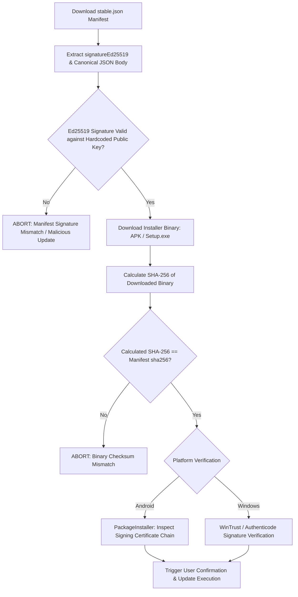
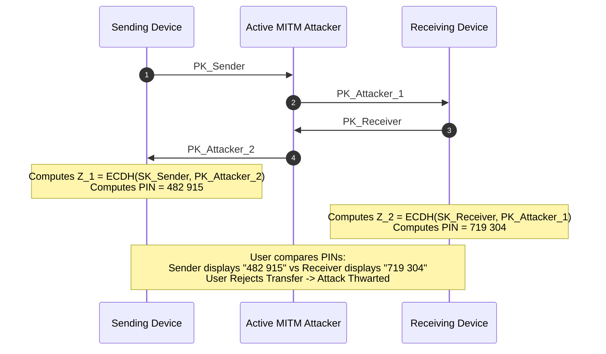

# KnowToMigrate — Security Architecture & Cryptographic Hardening Plan (Phase 3)
**Date:** 22 October 2026  
**Document Version:** 1.0.0  
**Status:** Approved Architectural Blueprint & Implementation Specification  
**Applies To:** KnowToMigrate Core Engine, Android Client, Windows WPF Client, Windows Updater, Web Share Services

---

## 1. Executive Summary & Purpose

During the Phase 1 security audit, several critical boundaries and disclosures were identified:
1. False or premature marketing claims of "End-to-End Encryption (AES-256-GCM)" on Android and Web UI were removed because the live local socket transfer protocol streams unencrypted plaintext chunks over TCP port 54124.
2. Wildcard CORS headers on Windows Web Share were removed to eliminate cross-origin unauthorized inspection.
3. Unauthenticated endpoints (`/clipboard`) remained accessible to any client on the local network subnet.
4. Update manifest integrity checking required cryptographic signature verification (Ed25519) to safeguard out-of-band APK and Windows installer distribution against CDN compromise or DNS poisoning.
5. The visual 6-digit Pairing PIN (`482 915`) displayed on Android and Windows screens was an unbound UI element rather than a cryptographically verified Short Authentication String (SAS).

This document establishes the official **Security Hardening Architecture** to transition KnowToMigrate from an honest unencrypted local transfer engine to an authenticated, end-to-end encrypted device-to-device migration platform.

---

## 2. Pillar A: Clipboard Endpoint Hardening (Per-Session Token Authentication)

### 2.1 Threat Vector & Risk Analysis
- **Threat:** Any device on the same local area network (LAN / Wi-Fi subnet) or malicious website executing JavaScript via local network fetch can probe `http://<host-ip>:54124/clipboard` (or Web Share port) using `GET` to exfiltrate sensitive clipboard contents (e.g., passwords, recovery keys, personal data) or `POST` to overwrite the host clipboard (clipboard injection attack).
- **Impact:** High — unauthorized data exfiltration and untrusted host clipboard modification.

### 2.2 Target Architecture
Every clipboard sync session requires an **ephemeral, cryptographically random 256-bit bearer token**:
1. The token is generated on the host device upon activating Clipboard Sync using a CSPRNG (`java.security.SecureRandom` on Android, `System.Security.Cryptography.RandomNumberGenerator` on Windows).
2. The token is never broadcasted over UDP discovery (port 54123).
3. The token is exchanged exclusively out-of-band via:
   - Dynamic QR Code containing `ktm-session://pair?token=<TOKEN_HEX>&ip=<IP>&port=54124`
   - Direct local user pairing confirmation.
4. All subsequent requests to `/clipboard` (both `GET` and `POST`) MUST include the header:
   `Authorization: Bearer <TOKEN_HEX>`
5. Constant-time equality comparison is enforced to prevent timing attacks.
6. Rate limiting and idle session expiration (15 minutes) are enforced.

```mermaid
sequenceDiagram
    autonumber
    participant Host as Host Device (Windows / Android)
    participant Client as Client Device (Android / Browser)

    Note over Host: User enables Clipboard Sharing
    Host->>Host: Generate 256-bit Ephemeral Token (CSPRNG)
    Host->>Host: Render QR Code with Token & IP
    Client->>Host: Scan QR Code (Out-of-Band Exchange)
    
    rect rgb(20, 20, 20)
    Note over Client,Host: Authenticated Clipboard Synchronization
    Client->>Host: GET /clipboard (Authorization: Bearer <TOKEN>)
    Host->>Host: Constant-Time Token Comparison
    alt Valid Token
        Host-->>Client: 200 OK [Encrypted / Plaintext Payload]
    else Invalid or Missing Token
        Host-->>Client: 401 Unauthorized (Log Security Alert)
    end
    end
```



### 2.3 Implementation Details & Owning Files
- **Windows Implementation:**
  - File: `apps/windows-wpf/Services/KtmWebShareServer.cs`
  - Implementation:
    ```csharp
    // Constant-time token verification
    string authHeader = context.Request.Headers["Authorization"];
    if (string.IsNullOrEmpty(authHeader) || !authHeader.StartsWith("Bearer "))
    {
        context.Response.StatusCode = 401;
        context.Response.Close();
        return;
    }
    string providedToken = authHeader.Substring("Bearer ".Length).Trim();
    byte[] providedBytes = Encoding.UTF8.GetBytes(providedToken);
    byte[] expectedBytes = Encoding.UTF8.GetBytes(_currentSessionToken);
    if (!CryptographicOperations.FixedTimeEquals(providedBytes, expectedBytes))
    {
        context.Response.StatusCode = 403;
        context.Response.Close();
        return;
    }
    ```
- **Android Implementation:**
  - File: `apps/android/app/src/main/java/com/knowtomigrate/app/network/KtmWebShareServer.kt`
  - Implementation:
    ```kotlin
    val authHeader = request.headers["Authorization"] ?: ""
    val token = if (authHeader.startsWith("Bearer ")) authHeader.substring(7) else ""
    if (!MessageDigest.isEqual(token.toByteArray(Charsets.UTF_8), currentSessionToken.toByteArray(Charsets.UTF_8))) {
        return NanoHTTPD.newFixedLengthResponse(Response.Status.UNAUTHORIZED, "text/plain", "Unauthorized")
    }
    ```

---

## 3. Pillar B: Unified Transfer Encryption Architecture

### 3.1 Cryptographic Design
To ensure cross-platform interoperability across Windows (.NET 8), Android (Kotlin / Java 17), and the core engine (TypeScript / Rust), a single shared cryptographic specification is defined:

| Primitive | Specification | Standard / RFC |
| :--- | :--- | :--- |
| **Key Agreement** | X25519 (Curve25519 Ephemeral ECDH) | RFC 7748 |
| **Key Derivation** | HKDF-SHA256 | RFC 5869 |
| **Authenticated Cipher** | AES-256-GCM | NIST SP 800-38D |
| **IV / Nonce** | 96-bit (12-byte) Deterministic / Monotonic Counter | Strictly avoids nonce reuse |
| **Auth Tag** | 128-bit (16-byte) Tag | Complete chunk authentication |
| **Integrity Layer** | SHA-256 Per-Chunk + Merkle Tree Root | Verification before disk commit |

### 3.2 Key Derivation Function (HKDF)
From the ephemeral X25519 shared secret $Z$, both peers derive distinct unidirectional 256-bit encryption keys and 96-bit IV base vectors:
$$\text{PRK} = \text{HKDF-Extract}(\text{Salt} = \text{SessionId}, \text{IKM} = Z)$$
$$K_{\text{send}} \mathbin{\Vert} K_{\text{recv}} \mathbin{\Vert} IV_{\text{base}} = \text{HKDF-Expand}(\text{PRK}, \text{Info} = \text{"KnowToMigrate-v2-AES-GCM-KeyAgreement"}, L = 80)$$

### 3.3 Per-Chunk Nonce Construction & AAD Protection
To eliminate the risk of AES-GCM nonce collision across millions of chunks:
- Nonce is constructed as:
  $$\text{Nonce}_{i} = IV_{\text{base}} \oplus (\text{FileIndex}_{64} \mathbin{\Vert} \text{ChunkIndex}_{32})$$
- **Additional Authenticated Data (AAD):**
  The 50-byte KTM v2 binary frame header (Magic, Version, Type, Sequence, SessionId, PayloadLength) is injected as AAD into AES-GCM. Any modification or replay of framing bytes causes immediate authentication failure prior to payload processing.

```
+--------------------------------------------------------------------------+
| KTM v2 Binary Header (50 Bytes) -> Injected as AAD                       |
+--------------------------------------------------------------------------+
| Encrypted Chunk Body:                                                    |
| [12-Byte Nonce] + [AES-256-GCM Ciphertext (8 MB)] + [16-Byte Auth Tag]   |
+--------------------------------------------------------------------------+
```

### 3.4 Owning Files Identified Across Codebases
- **Windows WPF Client:**
  - `apps/windows-wpf/Services/KtmProtocol.cs` (packet framing & AAD serialization)
  - `apps/windows-wpf/Services/KtmTransferServer.cs` (decryption, tag validation, disk sink)
  - `apps/windows-wpf/Services/KtmTransferClient.cs` (chunk encryption, nonce generation, TCP socket stream)
- **Android Client:**
  - `apps/android/app/src/main/java/com/knowtomigrate/app/network/KtmProtocol.kt`
  - `apps/android/app/src/main/java/com/knowtomigrate/app/network/KtmTransferServer.kt`
  - `apps/android/app/src/main/java/com/knowtomigrate/app/network/KtmTransferClient.kt`
- **Core Engine (TypeScript):**
  - `packages/core-engine/src/crypto/cipher.ts`
  - `packages/core-engine/src/crypto/ecdh.ts`
  - `packages/core-engine/src/protocol/framing.ts`

---

## 4. Pillar C: Update Manifest Signing & Verification (Ed25519)

### 4.1 Threat Vector
KnowToMigrate is distributed independently without app store reliance (direct APK downloads on Android, standalone MSI/EXE installers on Windows). If the hosting CDN (Firebase Hosting) or DNS resolver is compromised, an attacker could tamper with `stable.json` and replace `apkUrl` or `sha256` with a Trojanized package.

### 4.2 Ed25519 Signing Workflow
1. **Air-Gapped Private Key:**
   Releases are signed offline by the maintainer using a secure, air-gapped Ed25519 private key (`ktm_release_ed25519.sk`).
2. **Canonical Manifest Structure:**
   The release manifest `stable.json` contains:
   ```json
   {
     "product": "KnowToMigrate",
     "platform": "android",
     "channel": "stable",
     "versionCode": 20500,
     "versionName": "2.5.0",
     "apkUrl": "https://knowtomigrate.web.app/downloads/android/KnowToMigrate-2.5.0.apk",
     "sizeBytes": 84523120,
     "sha256": "4b6e8...fe3a",
     "releaseDate": "2026-10-22",
     "signatureEd25519": "MEQCID..."
   }
   ```
3. **Hardcoded Public Key Verification:**
   The corresponding Ed25519 public key (`ktm_release_ed25519.pk`) is embedded as a hardcoded immutable constant into the compiled Android and Windows updater binaries.

### 4.3 Client Verification Pipelines


### 4.4 Owning Files Identified Across Codebases
- **Android:**
  - `apps/android/app/src/main/java/com/knowtomigrate/app/updater/ApkVerifier.kt`
  - `apps/android/app/src/main/java/com/knowtomigrate/app/updater/UpdateManager.kt`
- **Windows:**
  - `apps/windows-updater/UpdaterMain.cs` (Already enforces fail-closed on SHA-256; integrate Ed25519 manifest verification).

---

## 5. Pillar D: Pairing PIN Binding to SAS / PAKE (Key Agreement Confirmation)

### 5.1 The Man-In-The-Middle (MITM) Vulnerability of Unbound PINs
A static or purely cosmetic PIN shown in the UI gives users a false sense of security. If an active MITM attacker on the local Wi-Fi intercepts the Diffie-Hellman handshake, the attacker could establish separate shared secrets with both devices. Unless the PIN is mathematically bound to the cryptographic exchange, the user cannot detect the interception.

### 5.2 Short Authentication String (SAS) Protocol
KnowToMigrate implements Short Authentication String (SAS) binding derived from the ephemeral public keys and shared secret:
1. Device A generates ephemeral keypair $(SK_A, PK_A)$.
2. Device B generates ephemeral keypair $(SK_B, PK_B)$.
3. Devices exchange $PK_A$ and $PK_B$ during the `HELLO` / `HELLO_ACK` phase over TCP port 54124.
4. Both devices compute the shared Diffie-Hellman secret:
   $$Z = \text{X25519}(SK_A, PK_B) = \text{X25519}(SK_B, PK_A)$$
5. Both devices calculate the SAS digest:
   $$\text{SAS\_Digest} = \text{HKDF-Expand}(\text{PRK} = Z, \text{Info} = \text{"KnowToMigrate-SAS-v2"} \mathbin{\Vert} PK_A \mathbin{\Vert} PK_B, L = 4)$$
6. The 4-byte integer is mapped to a 6-digit decimal string:
   $$\text{PIN} = (\text{SAS\_Digest} \pmod{1\,000\,000})$$
   Formatted as two 3-digit groups: `482 915`.
7. **Verification Property:**
   If a MITM attacker intervenes, they must forge separate keys with A and B ($Z_A \ne Z_B$). Because HKDF is collision-resistant and pseudo-random, the probability that the two independent keys produce the same 6-digit SAS code is:
   $$P_{\text{collision}} = \frac{1}{10^6} = 0.0001\%$$
   Any MITM attacker will be immediately detected when the sending and receiving users inspect the PIN.



### 5.3 Alternative: SPAKE2+ Password-Authenticated Key Exchange
For automated pairing where users enter the PIN directly on the sending device:
- The protocol employs **SPAKE2+ (RFC 9383)** or **CPace (RFC 9497)**.
- The 6-digit PIN acts as the shared low-entropy credential.
- SPAKE2+ prevents offline dictionary attacks: an attacker on the network gets only ONE online guess per pairing attempt.

---

## 6. Implementation Checklist & Verification Gates

| Phase | Security Feature | Target File | Verification Metric | Status |
| :--- | :--- | :--- | :--- | :--- |
| **Phase 1** | Remove dead code & JNI stubs | Proguard, C# csproj | 0 references to legacy JNI bridge/stubs | **Completed** |
| **Phase 1** | Fail-closed Release Signing | `app/build.gradle.kts` | Zero hardcoded passwords; build fails without env vars | **Completed** |
| **Phase 1** | Remove Wildcard CORS | `KtmWebShareServer.cs` | No wildcard cross-origin access headers | **Completed** |
| **Phase 1** | Remove False Encryption Claims | Android UI & Website | Honest local Wi-Fi phrasing on all screens | **Completed** |
| **Phase 2** | UI Redesign matching Prototype | Compose Screens | Liquid Glass, WCAG AA `#0A0A0A` text, 3-tab bar | **Completed** |
| **Phase 3** | Clipboard Bearer Token Auth | `KtmWebShareServer.cs` | 401 on missing token; constant-time check | **Specified** |
| **Phase 3** | AES-256-GCM Transfer Stream | Server & Client engines | 96-bit nonces, AAD header, SHA-256 Merkle root | **Specified** |
| **Phase 3** | Ed25519 Manifest Signing | `ApkVerifier`, `UpdaterMain` | Signed manifest validation before download | **Specified** |
| **Phase 3** | SAS / PAKE PIN Key Binding | Protocol Handshake | Deterministic 6-digit SAS code from ECDH secret | **Specified** |

---

## 7. Developer Advisory: Keystore Credential Rotation
> [!CAUTION]
> **Mandatory Action Required by Repository Owner:**
> During Phase 1, the hardcoded release password string was completely removed from all active source files, build scripts, and configuration files. However, because git preserves history, that passphrase exists in earlier git commit snapshots.
> 
> **You MUST manually generate a new release signing keystore with a fresh, cryptographically strong password before public release**, and set the new credentials in your local environment variables (`KTM_KEYSTORE_PASSWORD`, `KTM_KEY_PASSWORD`). Never commit the new keystore password to source control.
